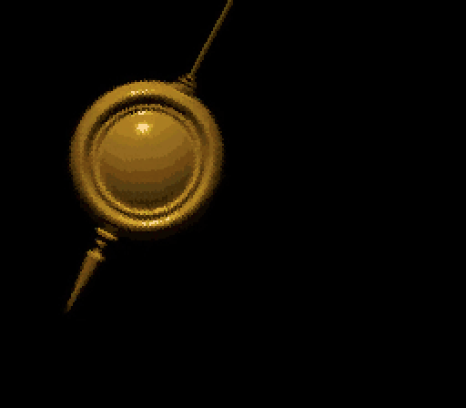
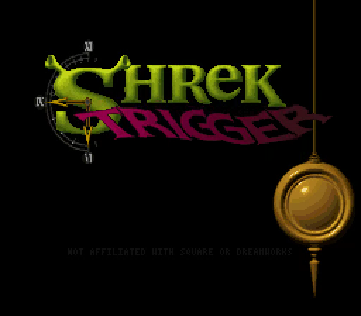
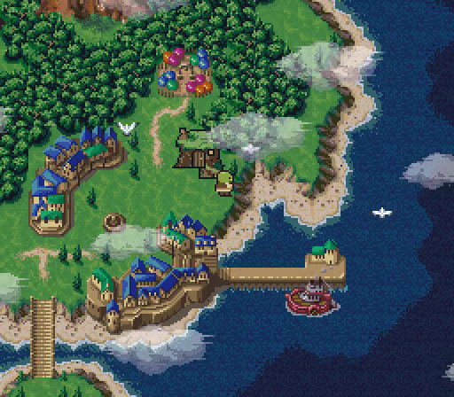
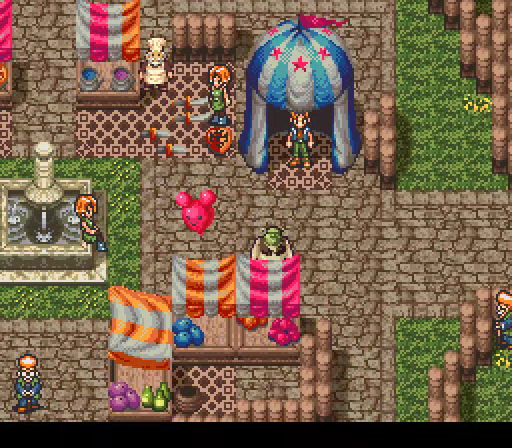
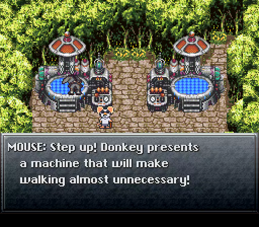
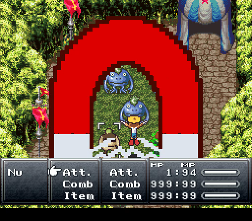
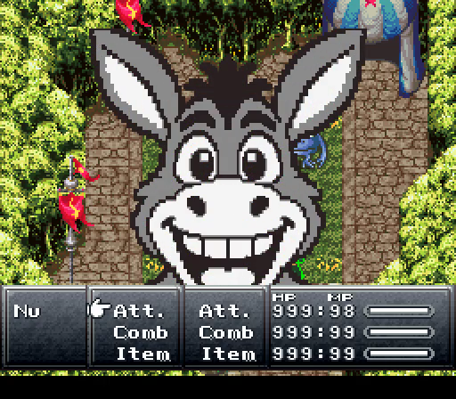
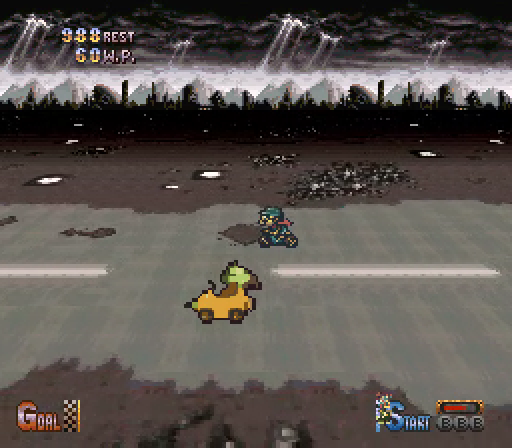
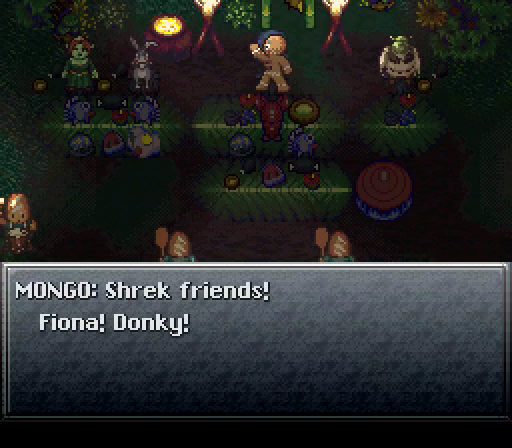

# Shrek Trigger

**A swamp through time.** Shrek Trigger is a parody ROM hack of *Chrono Trigger* (SNES, USA) that recasts the whole adventure with Shrek, his friends and a lot of people who should not be in a time-travel epic.

[](https://mikolalysenko.github.io/shrek-trigger/media/shrek-trigger-intro.mp4)

**[Play in your browser](https://mikolalysenko.github.io/shrek-trigger/)** · **[Download the patch](https://github.com/mikolalysenko/shrek-trigger/releases/latest)** · [Intro (3 min)](https://mikolalysenko.github.io/shrek-trigger/media/shrek-trigger-intro.mp4) · [Teaser trailer](https://mikolalysenko.github.io/shrek-trigger/media/shrek-trigger-teaser.mp4)

## The story so far

Shrek wants one quiet day in his swamp. Instead there is a fair in Duloc, a princess with a missing pendant, and Donkey's brand-new invention, which is absolutely safe and will definitely not tear a hole in time.

What follows is the full Chrono Trigger campaign, rewritten: every town, every chapter, and the endings. It keeps the original maps, music engine and battle system, and replaces the people, the jokes and a great deal of the noise.

- **Seven playable characters**, each with new battle sprites, portraits and personality: Shrek, Fiona, Donkey, Pinocchio, Puss in Boots, Mongo, and one more you would never let into your party.
- **116 techniques**, all renamed and many redrawn as full-screen gags: Fart, Swamp Belch, Magnets!, Are We There Yet?, Call My Wife and the rest. Every combination built on a fart is a fart. Some techniques are deliberately overpowered or useless, because the joke was better that way.
- **A rewritten script** of more than 5,000 lines: townsfolk, quests, side stories and all the endings.
- **New music**: an All Star arrangement greets you at the title, and other cues get swamp, carnival and flight remixes, all played on the SNES's own instruments.
- **Ogre economics**: you pay in toenails, heal with onions and recover magic with garlic. Your stats are Beef, Zoom, Mojo, Layer and Earwax.
- **Guest stars you did not ask for**, including a celebrity chef who teaches magic and an optional superboss who is very worldwide.

Enemy and boss balance is the original game's, so it plays like Chrono Trigger: it just smells worse.

## Screenshots

| | |
| :---: | :---: |
|  |  |
|  |  |
|  |  |
|  |  |

## Play in your browser

Open **<https://mikolalysenko.github.io/shrek-trigger/>** and choose your own Chrono Trigger (USA) ROM. The page checks it, applies the release patch inside your browser and starts the game. The ROM never leaves your device and no ROM is hosted here; your browser remembers it, so next time you just press Play.

Hosting the player yourself? Put your ROM beside `index.html` as `rom.sfc` (or `chrono-trigger.sfc`, `Chrono Trigger (USA).sfc`), or link to `index.html?rom=path/to/your.sfc`, and the page loads and patches it automatically. Keep such a copy private: never publish a ROM.

Arrow keys move, **Z** confirms, **X** cancels (hold to run), **C** opens the menu, **Esc** pauses, **F** goes full screen. Gamepads work, and phones and tablets get an on-screen SNES pad in portrait or landscape. Saves made at save points are kept in your browser. Developer debug tools are on a separate page, `dev.html`.

## Patching

You need your own copy of **Chrono Trigger (USA)** for the SNES. This repository and its releases do not contain the game.

| | |
| --- | --- |
| Expected ROM | Chrono Trigger (USA), no header, 4,194,304 bytes |
| CRC32 | `2D206BF7` |
| SHA-1 | `de5822f4f2f7a55acb8926d4c0eaa63d5d989312` |
| SHA-256 | `06d1c2b06b716052c5596aaa0c2e5632a027fee1a9a28439e509f813c30829a9` |

If your file is 4,194,816 bytes it has a 512-byte copier header. Remove it first (most patchers have a "remove header" option, or use a tool such as [Rom Patcher JS](https://www.marcrobledo.com/RomPatcher.js/)).

1. Download `shrek-trigger-1.0.0.bps` from the [latest release](https://github.com/mikolalysenko/shrek-trigger/releases/latest).
2. Apply it to the ROM with a BPS patcher: [Rom Patcher JS](https://www.marcrobledo.com/RomPatcher.js/) in the browser, [Flips](https://github.com/Alcaro/Flips), or [beat](https://www.romhacking.net/utilities/893/).
3. Play the result in a current emulator such as [Snes9x](https://www.snes9x.com/), [bsnes](https://github.com/bsnes-emu/bsnes) or RetroArch with either core.

The patched cartridge is **8 MiB (ExHiROM)**, CRC32 `0749CC1A`, SHA-1 `f23b55c17ab31101244a851cdc1fadc88e0008ee`. BPS checks both the source and the result for you.

An **IPS** version (`shrek-trigger-1.0.0.ips`) is included for tools that only take IPS. IPS cannot check your ROM, so verify the checksums above yourself.

It has been tested in Snes9x and bsnes. It has **not** been tested on real hardware or flash carts; an 8 MiB ExHiROM needs a cart that supports that mapping.

## Building from source

The patch is built from the code in this repository and your own ROM, which stays on your machine (`.local/` is ignored by git).

```sh
npm install
npm run rom:import -- '/path/to/Chrono Trigger (USA).sfc'
npm run build      # writes dist/shrek-trigger-1.0.0.bps and .ips, and a private .local/shrek-trigger.sfc
npm start          # the player at http://127.0.0.1:5173, debug tools at /dev.html
npm test           # the test suite (about 45 minutes)
```

[Development notes](docs/development.md) cover the architecture, tools and tests. Source and review images for the artwork are not included in this repository; the converted pixel data that goes into the cartridge is.

## Credits

Shrek Trigger was built by AI coding agents (Claude, Codex and Kimi) working for Mikola Lysenko. Character artwork comes from image generation and other sources recorded in [Credits and provenance](docs/credits.md), which also credits the music, the reverse-engineering references and the [SnesJs](https://github.com/angelo-wf/SnesJs) emulator core (MIT) used by the browser player.

## Legal

Shrek Trigger is an unofficial, non-commercial fan parody. It is not affiliated with, endorsed by or sponsored by Square Enix, DreamWorks Animation, Smash Mouth, or any person who appears in it. *Chrono Trigger* is © Square Enix. *Shrek* and its characters are © DreamWorks Animation. All other names and likenesses belong to their owners and appear here as parody.

No copyrighted ROM data is distributed: the patches contain only the changes, and you must supply your own legally obtained copy of the game.
